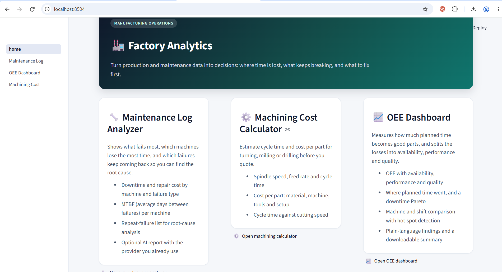
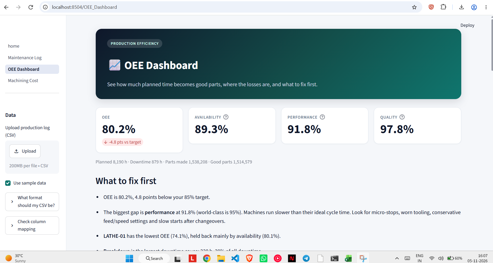

# 🏭 Factory Analytics

A web app with three tools for manufacturing operations: find what keeps breaking, measure how efficiently machines turn time into good parts, and estimate what a machining job costs.

- **Maintenance Log Analyzer**: finds the machines and failures that cost the most downtime, flags failures that keep repeating, and suggests where to start the root-cause analysis. Optional AI report.
- **OEE Dashboard**: calculates Overall Equipment Effectiveness (OEE = Availability × Performance × Quality), shows where planned time was lost, and ranks the causes of downtime.
- **Machining Cost Calculator**: estimates spindle speed, feed, cycle time and cost per part for turning, milling or drilling.

> **Live demo:** https://factory-analysis.streamlit.app/

## Screenshots

| Home | OEE dashboard |
|---|---|
|  |  |


## Features

**Maintenance Log Analyzer**
- Headline numbers: failures, downtime, repair cost, average downtime per failure
- Downtime and cost by failure type and by machine
- MTBF (mean time between failures) per machine
- Repeat-failure list for root-cause analysis
- Monthly trend of failures and downtime
- Plain-language recommendations, no API key needed
- Optional AI report from Anthropic, OpenAI-compatible services, or Google Gemini, downloadable as Markdown or HTML

**OEE Dashboard**
- OEE with availability, performance and quality, against a target you set
- Where planned time went: productive time, quality loss, speed loss and downtime
- Downtime Pareto by reason
- Comparison by machine and shift, with hot-spot detection
- Trends by day, week or month
- Findings and a downloadable machine and shift summary

**Machining Cost Calculator**
- Spindle speed, feed rate, passes and cycle time
- Cost per part split into material, machine time, tool wear and setup
- Cost per batch
- Cycle time against cutting speed, to show the trade-off with tool life

**All tools**
- Upload your own CSV. Columns are matched automatically, and you can correct any match in the sidebar.
- Format guide and blank template in each sidebar
- Rows with bad data are listed with the reason, never dropped silently

## Run it locally

Requires Python 3.10 or newer.

```bash
git clone https://github.com/<your-username>/factory-analytics.git
cd factory-analytics
pip install -r requirements.txt
streamlit run home.py
```

The app opens in your browser with sample data loaded.

## Your own data

Any file works as long as its columns can be matched to the ones below. Matching is automatic for common names such as `Asset` for `machine_id`, `Hours Down` for `downtime_hours`, or `Parts Made` for `total_count`. The **Check column mapping** panel lets you fix any match.

**Maintenance log**: one row per breakdown.

| Column | Meaning |
|---|---|
| `date` | Date of the breakdown (DD-MM-YYYY or YYYY-MM-DD) |
| `machine_id` | Machine name or code |
| `failure_type` | Type of breakdown |
| `downtime_hours` | Hours out of service |
| `repair_cost` | Cost of the repair |
| `technician` | Optional |

**Production log (OEE)**: one row per machine per shift.

| Column | Meaning |
|---|---|
| `date` | Day of production |
| `machine_id` | Machine name or code |
| `planned_time_min` | Minutes planned to run |
| `downtime_min` | Minutes stopped in that time |
| `ideal_cycle_time_sec` | Fastest realistic seconds per part |
| `total_count` | All parts made |
| `good_count` | Parts that passed inspection |
| `shift`, `downtime_reason` | Optional |

## Deploy on Streamlit Community Cloud

1. Push this repository to GitHub. Public repositories are free to host.
2. Go to [share.streamlit.io](https://share.streamlit.io) and sign in with GitHub.
3. Click **Create app**, choose this repository and branch `main`, and set the main file path to `home.py`.
4. Click **Deploy**.

No API keys are stored in the repository. Visitors who want the AI report enter their own key in the app.

## How it works

- `analyzer.py`, `oee.py` and `machining.py` contain all the calculations, with no web code, so they can be tested on their own.
- `colmap.py` matches the headers of an uploaded file to the names the analysis uses.
- `ai_report.py` calls the chosen AI provider over plain HTTP and sends only aggregated tables, never raw log rows.
- `ui.py` and `.streamlit/config.toml` hold the styling.
- OEE is calculated from summed minutes and counts, not by averaging percentages, so results stay correct across shifts and machines of different sizes.
- Machining formulas are standard shop-floor approximations. Cutting data should be confirmed against the tool supplier's catalogue.

## Project structure

```
home.py                          home page and navigation
pages/
  1_Maintenance_Log.py           maintenance analyzer
  2_OEE_Dashboard.py             OEE dashboard
  3_Machining_Cost.py            machining cost calculator
analyzer.py                      maintenance calculations
oee.py                           OEE calculations
machining.py                     cycle time and cost calculations
colmap.py                        automatic column matching
ai_report.py                     AI providers, report building and downloads
ui.py                            shared styling, headers, cards and footer
.streamlit/config.toml           theme
sample_maintenance.csv           demo maintenance log
sample_oee.csv                   demo production log
tools/                           scripts that regenerate the demo data
docs/                            screenshots for this README
requirements.txt
```

## Regenerate the demo data

```bash
python tools/make_maintenance_sample.py
python tools/make_oee_sample.py
```

## Limitations

- The sample data is synthetic. Results on a real factory's log will differ.
- Recommendations are rule-based suggestions to start an investigation, not conclusions.
- Machining estimates ignore machine acceleration, tool changes and fixturing time. Use them for quoting, then check against real runs.
- The AI report depends on the provider's service and model availability.

## Next steps

- Connect directly to a PLC or MES (for example OPC UA or Modbus) so data loads automatically. This needs access to the factory's own system.
- Add a cost view: value of lost good parts per hour of downtime.

## Tech stack

Python, pandas, Streamlit, requests, markdown. Optional: Anthropic, OpenAI-compatible APIs, Google Gemini.

## License

MIT. Add a `LICENSE` file with the MIT text before publishing.
